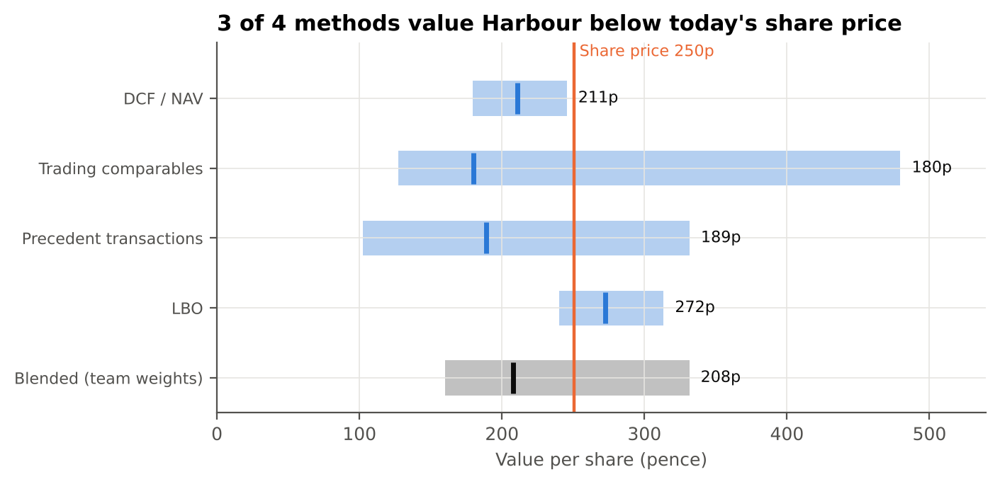

# Harbour Energy: BUY or SELL?

Code, data and outputs for our FI4008 (Machine Learning in Finance, University of Aberdeen) group assessment, Group 9.

We value **Harbour Energy plc (LSE: HBR)**, the largest London-listed independent oil and gas producer, as at the close on 20 November 2026 and make a 12-month BUY or SELL call. Four valuation methods (DCF, trading comparables, precedent transactions and an LBO) are blended with fixed weights. A logistic-regression model tests whether public monthly information can predict if Harbour will beat the FTSE 250 next month.

**Main finding: SELL, target price 208p** (share price 250.4p, −16.9%; about −12% after the 12.3p base dividend). Three of the four methods value the shares below the current price. The machine-learning model has no out-of-sample skill (test ROC-AUC 0.46, inside the range of a shuffled-label placebo), so the call rests on the valuation.

## Headline results

| Method | Weight | Low | Base | High |
|---|---|---|---|---|
| DCF / NAV (WACC 11% / 9% / 7%) | 40% | 180p | 211p | 245p |
| Trading comparables (peer 2027e EV/EBITDA) | 25% | 127p | 180p | 480p |
| Precedent transactions (EV per 2P barrel) | 20% | 102p | 189p | 332p |
| LBO (buyer's return 25% / 20% / 15%) | 15% | 240p | 272p | 313p |
| **Blended target price** | 100% | 160p | **208p** | 331p |

| Machine-learning model (test period Jan 2022 to Sep 2026, 57 months) | Value |
|---|---|
| ROC-AUC (bootstrap 95% range) | 0.46 (0.30 to 0.61) |
| Accuracy vs always predicting "underperform" | 47% vs 53% |
| Placebo: share of 200 shuffled-label models doing at least as well | 73% |
| Walk-forward ROC-AUC (refit every January) | 0.47 |
| Trading on the signal vs holding Harbour vs holding the FTSE 250 | +7% vs +20% vs +30% |
| Live signal for November 2026: chance Harbour beats the FTSE 250 | 53% |

The full tables are in `tables/` (T17 for the valuation, T05 and T10 for the model).



## How to reproduce

```
pip install -r requirements.txt     # Python 3.12 or later
python main.py                      # about 1 minute
```

`main.py` runs `data.py`, `market.py`, `models.py`, `evaluation.py`, `dcf.py`, `valuation.py` and `plots.py` in order. It rebuilds `tables/` (17 CSV files), `figures/` (6 PNG files) and `data/processed/` from the saved raw data. With the versions in `requirements.txt` the rebuilt tables are identical to the ones in this repository. The random seed is 42 throughout.

`notebooks/FI4008_group9_analysis.ipynb` runs `main.py` and then displays the key tables and figures.

| File | What it does |
|---|---|
| `main.py` | Runs every step in order and prints the results and checks |
| `data.py` | Shared settings, checks the raw files' SHA-256 hashes, reads each raw file, builds the monthly table for the model |
| `market.py` | Share-price record (return, volatility, worst fall, beta), financial summary, trading comparables |
| `models.py` | The logistic-regression pipeline, time-series tuning, walk-forward refits and the live signal |
| `evaluation.py` | Test metrics, bootstrap range, placebo test, coefficients and the money test |
| `dcf.py` | The DCF: price deck, production, costs, tax, hedges, discounting, sensitivity and scenarios. Every assumption is listed at the top with its source |
| `valuation.py` | Comparables, precedent deals, LBO, and the blend into a target price |
| `plots.py` | All 6 figures |
| `download_data.py`, `download_fred.py` | How the Yahoo Finance and FRED data were downloaded (documentation only; see below) |

## Data

Saved in `data/raw/`. The code only reads these files and never changes them:

- **Bloomberg** (university terminal, Excel add-in, 22 November 2026): monthly prices and total-return indices for Harbour and the FTSE 250 from January 2010, consensus forecasts, discount-rate inputs, Brent and UK gas futures, peer multiples and share performance, and the M&A deal list. Before April 2021 the Harbour series is Premier Oil, Harbour's legal predecessor; `data.py` checks it matches Yahoo's Harbour prices after the merger.
- **Yahoo Finance** (via `yfinance`): Brent crude futures and GBP/USD, daily.
- **FRED** (Federal Reserve Bank of St. Louis): the IMF European natural gas price, monthly.
- **Company reports**: Harbour's 2025 annual report, 2026 half-year results and 5 November 2026 trading update. The numbers taken from them are written into `dcf.py` and `valuation.py` with page or note references.
- **Deal press releases**: `data/manual/precedent_deals.csv` holds the deal value, reserves and production for each precedent deal, with a link to its source.

`data/raw/metadata.json` records each file's source and a SHA-256 hash. `main.py` stops if any file has changed. Rerunning the download scripts would overwrite the files with today's data, so the analysis only ever reads the saved files.

## How look-ahead bias and leakage are prevented

- Every predictor for month t uses data up to the end of month t only. The IMF gas price is a monthly average published after the month ends, so it is lagged one extra month.
- The target on row t is whether Harbour beats the FTSE 250 in month t+1. `data.py` checks this alignment with an assert.
- The split is chronological: training 2011 to 2021 (132 months) and test 2022 to 2026 (57 months). There is no shuffling.
- The one setting tuned (the regularisation strength C) is chosen on the training years only, with `TimeSeriesSplit` (5 folds, 1-month gap). Capping extreme values and scaling sit inside the scikit-learn `Pipeline`, so they are learned from training folds only.
- A **placebo** test (200 models trained on shuffled labels) shows what pure luck looks like, and a **walk-forward** refit each January checks the result does not depend on one fixed training window.

## Valuation in brief

- **Discount rate**: 9%. A CAPM cost of equity of 9.45% (10-year gilt 5.24% + Bloomberg adjusted beta 0.84 × 5% equity premium) gives a WACC of about 7%; Bloomberg's own cost of equity for Harbour is 11.2%. We use 9% because beta does not capture UK fiscal risk. `dcf.py` prints this calculation on every run. (The betas in T02 are lower because they are monthly regressions on the FTSE 250 over 1 to 5 years; Bloomberg's 0.84 is a 2-year weekly beta against the FTSE All-Share, adjusted towards 1.)
- **DCF / NAV**: production 500 kboe/d to 2030 (company guidance), then −12% a year to 2045; futures prices to 2029, then +2% a year; costs, capex and tax calibrated to 2026 actuals; existing hedges included; 9% discount rate. The equity bridge deducts net debt ($5.1bn), hybrid notes ($2.0bn), leases and after-tax decommissioning, and divides by about 1,776m voting-share equivalents (1,492m voting shares plus 251.5m unlisted non-voting shares, which carry a 13% higher entitlement to earnings and dividends). The comparables bridge also deducts leases, because Bloomberg's net debt includes them.
- **Trading comparables**: median 2027e EV/EBITDA of seven North Sea peers (EnQuest, Ithaca, Aker BP, Vår, DNO, OKEA, BlueNord).
- **Precedent transactions**: median enterprise value per barrel of 2P reserves in four North Sea deals, 2023 to 2026.
- **LBO**: the highest price a buyer borrowing 1.5x EBITDAX could pay and still earn 20% a year over five years.

`tables/T15_dcf_sensitivity.csv` and `tables/T16_dcf_scenarios.csv` show how the DCF changes with the discount rate, oil and gas prices, Harbour's own long-term price deck and a growth case.

## Output files

Files in `tables/` and `figures/` are numbered T01 to T17 and F01 to F06 in the order `main.py` makes them. `tables/run_log.txt` is the console output of a full run.

## Use of generative AI

We used Claude (Anthropic) to help write and review the code and to organise the data downloads. The group chose the approach, the assumptions and the weights, and checked every number in the report and presentation against this code, the saved data and the source documents.
